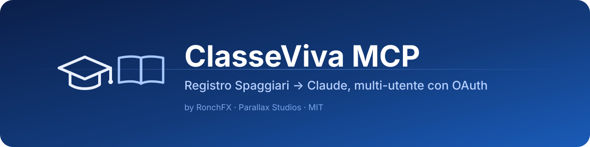
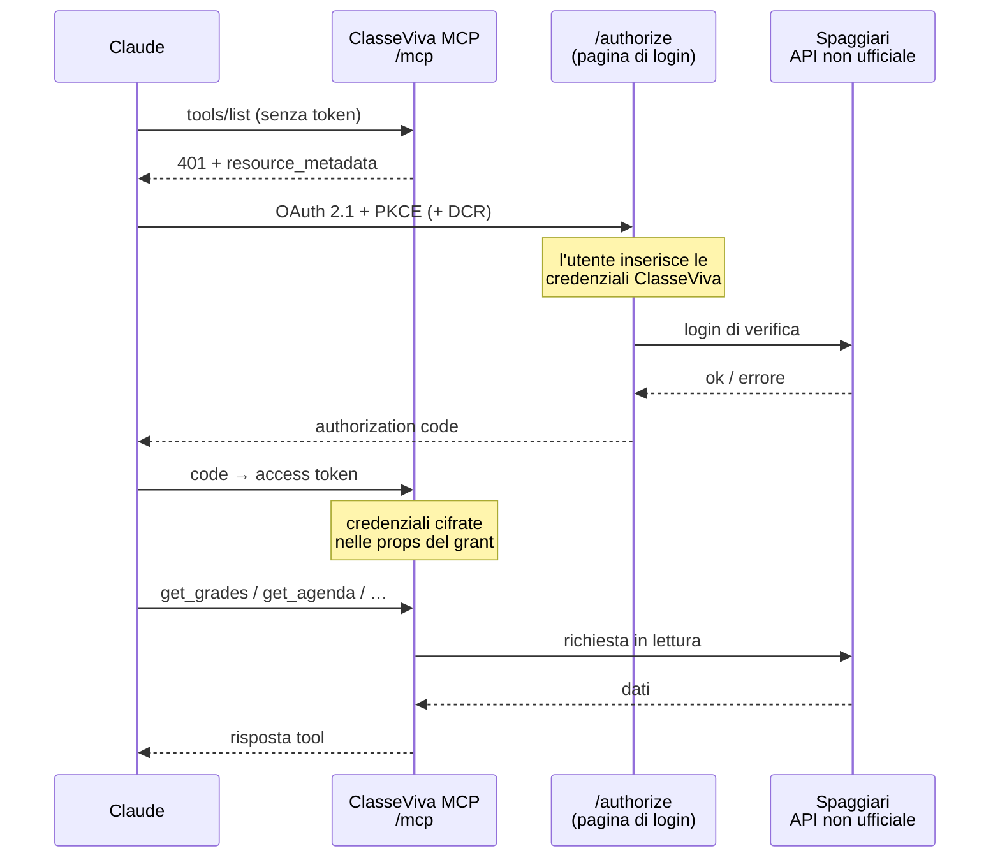

<p align="center">
  
</p>

<h1 align="center">ClasseViva MCP</h1>

<p align="center">
  <strong>Il tuo registro Spaggiari, dentro Claude.</strong><br/>
  Server MCP remoto multi-utente con login OAuth — open source, gratis, self-hostable.
</p>

<p align="center">
  <a href="LICENSE"></a>
  <a href="https://workers.cloudflare.com/"></a>
  <a href="https://modelcontextprotocol.io/"></a>
  <a href="https://www.typescriptlang.org/"></a>
  
  <a href="https://github.com/leoron04/classeviva-mcp/actions"></a>
</p>

> ⚠️ **Progetto non ufficiale.** Non è affiliato, sponsorizzato né approvato da Gruppo Spaggiari Parma S.p.A. Usa l'API **non documentata** dell'app ClasseViva (`web.spaggiari.eu/rest/v1`), solo in **lettura**, e può smettere di funzionare in qualsiasi momento. Vedi [Disclaimer](#disclaimer).

---

## Come si usa in Claude

1. Apri Claude (web, desktop o app) → **Impostazioni → Connettori → Aggiungi connettore personalizzato**.
2. Nome: `ClasseViva` — URL:
   ```
   https://classeviva-mcp.ronchfx.workers.dev/mcp
   ```
3. Lascia **vuoti** Client ID e Client Secret (la registrazione OAuth è automatica).
4. Premi **Connetti**: si apre una pagina di login in italiano. Inserisci codice utente (o email) e password di ClasseViva. Se hai più profili (es. genitore) puoi indicare il codice profilo.
5. Fatto. Puoi chiedere cose come: *«Che voti ho preso questa settimana?»*, *«Media in matematica?»*, *«Cosa c'è in agenda per domani?»*.

Per scollegarti rimuovi il connettore. Se cambi la password di ClasseViva, ricollega il connettore.

Preferisci la tua istanza? Vai a [Self-hosting](#self-hosting).

---

## Funzionalità (11 tool, sola lettura)

| | Tool | Cosa fa |
|---|---|---|
| 👤 | `get_profile` | Nome, scuola, città — utile per verificare il login |
| 📊 | `get_grades` | Voti con medie per materia e generale (`materia`, `periodo`, `ultimi`) |
| 📅 | `get_agenda` | Compiti e verifiche tra `dal` e `al` (default: oggi → +14 gg) |
| 📖 | `get_lessons` | Argomenti delle lezioni (default: ultimi 7 giorni) |
| 🚪 | `get_absences` | Assenze, ritardi, uscite + quante da giustificare |
| 📢 | `get_noticeboard` | Circolari della bacheca (**non** le segna come lette) |
| 📝 | `get_notes` | Note disciplinari, annotazioni, richiami, sanzioni |
| 📚 | `get_subjects` | Materie e docenti |
| 🗓️ | `get_periods` | Trimestri / quadrimestri con le date |
| 🗂️ | `get_didactics` | Materiali condivisi dai docenti (Didattica) |
| 🏫 | `get_calendar` | Giorni di lezione e vacanze in un intervallo |

Date in formato `YYYY-MM-DD` (fuso `Europe/Rome`). ClasseViva espone **solo l'anno scolastico in corso**. I voti blu/annullati non entrano nelle medie.

---

## Come funziona (OAuth)



---

## Sicurezza e privacy

- **OAuth 2.1 con PKCE**, Dynamic Client Registration e discovery standard, tramite [`@cloudflare/workers-oauth-provider`](https://github.com/cloudflare/workers-oauth-provider).
- Dopo il login, username e password **non sono salvati in chiaro**: restano solo nelle *props* del grant, **cifrate con AES-GCM** (chiave avvolta dal token). Nel KV di Cloudflare ci sono hash dei token e blob cifrati.
- Il server **non tiene una copia** di voti o agenda: ogni domanda viene girata a ClasseViva in quel momento. La sessione Spaggiari (~90 min) vive solo in memoria e si rinnova da sola.
- Nel database l'utente è uno **pseudonimo** (HMAC dell'username), non l'username in chiaro.
- Login protetto da **CSRF**, cookie `__Host-`, controllo `Origin`, no-iframe, CSP restrittiva, rate limit (IP + username) e tetto ai fallimenti.
- **Nessun log** di credenziali o dati personali. Access token ~1 ora; il grant scade dopo 60 giorni di inutilizzo.

**Limiti onesti.** Spaggiari non offre un login delegato: il server *deve* poter usare la tua password per parlare con l'API. Devi fidarti di chi gestisce l'istanza e del codice (tutto qui, open source). L'API è **non ufficiale** e può cambiare o essere bloccata. L'istanza pubblica è pensata per **uso personale e tra amici consapevoli**; se gestisci i dati di altri (soprattutto minorenni) sei responsabile secondo il **GDPR** — in quel caso **self-hosta** la tua copia e non riusare l'istanza pubblica come servizio generico.

---

## Self-hosting

Account Cloudflare gratuito + Node.js ≥ 20.

```bash
git clone https://github.com/leoron04/classeviva-mcp.git
cd classeviva-mcp
npm install
npx wrangler login

# 1. KV per OAuth — copia l'id in wrangler.toml ([[kv_namespaces]])
npx wrangler kv namespace create OAUTH_KV

# 2. Chiave per gli pseudonimi utente (consigliata)
openssl rand -hex 32 | npx wrangler secret put SUBJECT_KEY

# 3. Pubblica
npx wrangler deploy
```

Il connettore sarà `https://classeviva-mcp.<tuo-sottodominio>.workers.dev/mcp`. Opzionale: `PUBLIC_URL` in `wrangler.toml` se usi un dominio personalizzato.

### Variabili e binding

| Nome | Tipo | Descrizione |
|---|---|---|
| `OAUTH_KV` | KV (obbligatorio) | Client, grant e token OAuth (hash + props cifrate) |
| `LOGIN_LIMITER` | Rate limit | 5 tentativi di login/min per IP e username |
| `SUBJECT_KEY` | secret | ≥ 32 caratteri, pseudonimi utente |
| `ALLOWED_USERS` | secret | opzionale: username ClasseViva ammessi, separati da virgola. Se impostato, l'istanza diventa privata |
| `PUBLIC_URL` | var | URL pubblico canonico |
| `CLASSEVIVA_BASE_URL` | var | API alternativa (es. mock locale) |
| `CLASSEVIVA_USER` / `PASS` / `IDENT` / `MCP_SECRET` | secret (legacy) | Solo modalità single-user deprecata |

### Modalità legacy (deprecata)

La v1 esponeva `/mcp/<MCP_SECRET>` con un solo utente nei secret del Worker. Resta disponibile se imposti tutti i secret legacy, altrimenti risponde 404. Preferisci OAuth: verrà rimossa.

---

## Sviluppo locale

```bash
cp .dev.vars.example .dev.vars   # punta al mock Spaggiari
npm install
node test/mock-spaggiari.mjs &   # :9999 — qualsiasi password tranne "wrong"
npm run dev                      # http://localhost:8787
CLASSEVIVA_USER=S1234567X CLASSEVIVA_PASS=prova npm run test:e2e -- http://localhost:8787
```

`test/e2e-oauth.mjs` copre discovery, DCR, login, PKCE, token, refresh, `initialize`, `tools/list` e i tool. Contro un deploy reale usa le tue credenziali da env e **non** stampa dati personali. In CI gira solo contro il mock: `npm run test:local`.

### Struttura

```
src/worker.ts       OAuthProvider (/authorize, /token, /register, /mcp) + legacy
src/authorize.ts    login: CSRF, rate limit, verifica Spaggiari, grant
src/pages.ts        HTML (login, home, errori)
src/mcp.ts          server MCP (Streamable HTTP, stateless)
src/tools.ts        gli 11 tool
src/classeviva.ts   client API + rinnovo sessione
src/clients.ts      cache in-memory delle sessioni
src/legacy.ts       /mcp/<MCP_SECRET> (deprecato)
```

---

## FAQ

**Le mie credenziali finiscono in chat / nel README?** No. Restano cifrate nel grant OAuth; non sono nel codice né nell'URL del connettore.

**Devo aggiornare qualcosa ogni 90 minuti?** No. Il server rinnova da solo la sessione Spaggiari alla richiesta successiva.

**Funziona con ChatGPT / altri client?** Se il client supporta MCP remoto con OAuth 2.1 (PKCE + DCR), sì. È pensato e testato con Claude.

**Posso usarlo per tutta la scuola?** Tecnicamente sì, ma **non** è consigliato sull'istanza pubblica: privacy (GDPR) e ToS Spaggiari. Self-hosta e ottieni il consenso.

**Ho cambiato la password di ClasseViva.** Scollega e ricollega il connettore in Claude.

---

## Disclaimer

Progetto personale open source, **non ufficiale** e **non affiliato** a Gruppo Spaggiari Parma S.p.A. né alle scuole. «ClasseViva» e «Spaggiari» sono marchi dei rispettivi titolari. Usa un'API interna non documentata (la stessa dell'app mobile; la `Z-Dev-ApiKey` nel codice è quella pubblica dell'app, già presente in altri progetti open source) che può cambiare o essere bloccata. L'uso potrebbe non essere conforme ai termini di Spaggiari: usalo **a tuo rischio**, solo con account di cui hai diritto, e solo in lettura. Il software è fornito «così com'è», senza garanzie — vedi [LICENSE](LICENSE).

---

## Credits

- Autore: **Leonardo Ronchi** ([RonchFX](https://github.com/leoron04) / Parallax Studios)
- Librerie: [Model Context Protocol SDK](https://github.com/modelcontextprotocol/typescript-sdk), [Cloudflare workers-oauth-provider](https://github.com/cloudflare/workers-oauth-provider), [Wrangler](https://developers.cloudflare.com/workers/)
- Ispirazione dalle API reverse-engineerate usate da progetti come Classeviva.py (non affiliati)

Segnalazioni di sicurezza: vedi [SECURITY.md](SECURITY.md). Contributi: [CONTRIBUTING.md](CONTRIBUTING.md).

---

## English

**ClasseViva MCP** is an unofficial, open-source remote MCP server that connects the Italian school e-register **ClasseViva (Spaggiari)** to **Claude** (and other OAuth-capable MCP clients). Multi-user: each person signs in with their own credentials on an OAuth 2.1 (PKCE + dynamic client registration) login page. Credentials are **never stored in plaintext** — only inside the grant props, encrypted by `@cloudflare/workers-oauth-provider`. All **11 tools are read-only** (grades with averages, agenda, lessons, absences, noticeboard, notes, subjects, periods, teaching materials, calendar).

- **Quick start in Claude:** Settings → Connectors → Add custom connector → URL `https://classeviva-mcp.ronchfx.workers.dev/mcp`.
- **Self-host:** free Cloudflare Workers plan — create `OAUTH_KV`, set `SUBJECT_KEY`, `wrangler deploy` (see above).
- **Privacy note:** the public instance is for personal / friends use; for other people’s data (esp. minors) self-host and follow GDPR.
- **Disclaimer:** not affiliated with Gruppo Spaggiari Parma S.p.A.; undocumented API may break; use only with accounts you are allowed to access, at your own risk.

License: [MIT](LICENSE) © 2026 Leonardo Ronchi / RonchFX · Parallax Studios
